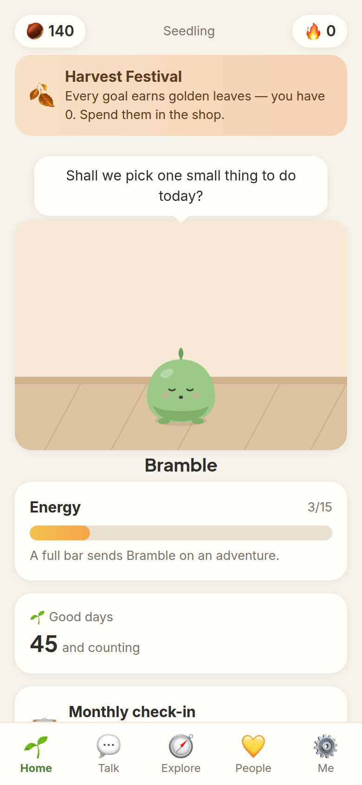
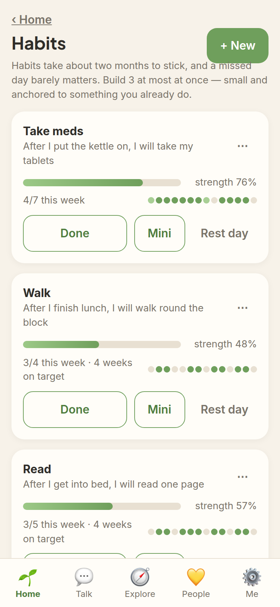
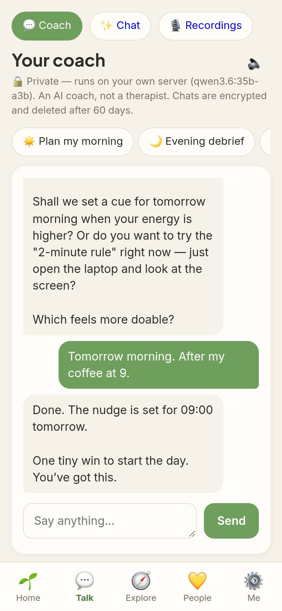
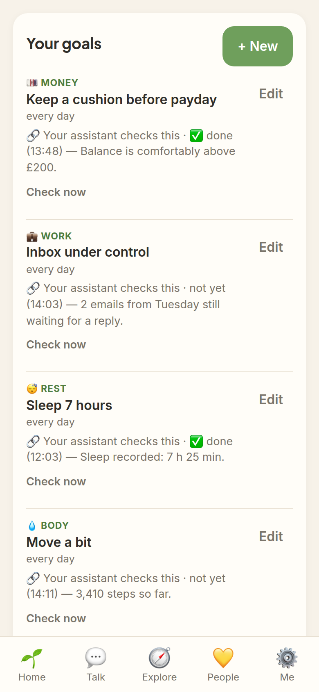
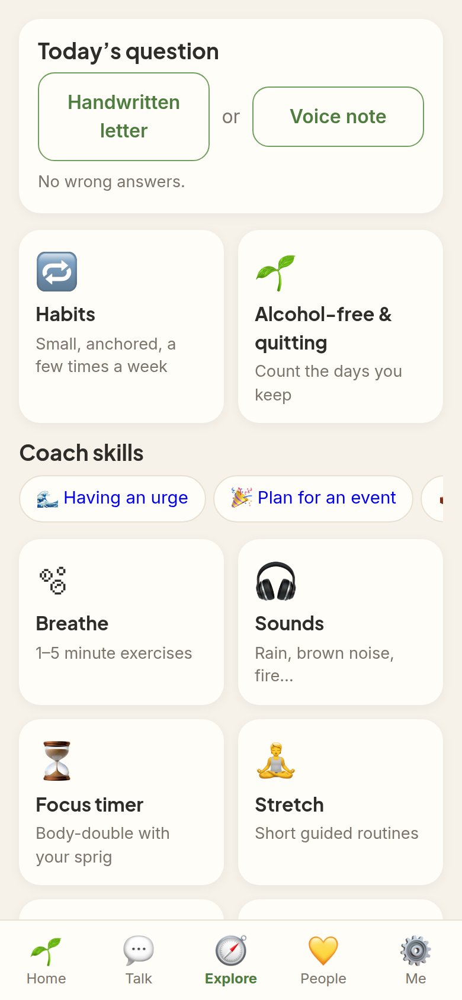
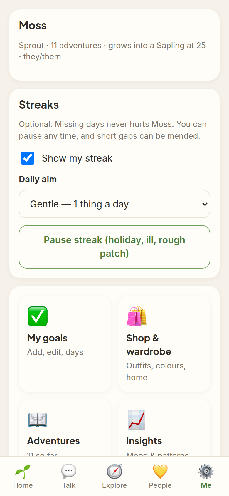

# Pippin 🌱

**Pippin is a dad's companion: a family app for chores, pocket money, messages, a little reading and a calm place for the grown-ups too. For parents, or anyone.**

Pippin runs on a computer or small server in your home. Everyone uses it from their phone or a browser, and it can be
installed on the home screen like an app. Each child gets their own simple app, with a little sprig to look after as
they go. Parents get a Family section to see how things are going. Every grown-up gets a calm space of their own:
check-ins, a few habits, breathing and an optional AI coach.

Nothing is sent to a company. There's no account to create with us, no ads and no telemetry. What your family enters
stays on your server.

<p align="center">
  
  
  
</p>
<p align="center">
  
  
  
</p>
<p align="center"><sub>Screenshots use a demo account with made-up data.</sub></p>

> **Not therapy, not a medical device.** Pippin is a family app and a self-help tool. It doesn't diagnose or treat
> anything. If you're struggling, speak to your GP. **In crisis (UK):** Samaritans 116 123 · text SHOUT to 85258 ·
> emergency 999. Elsewhere: [findahelpline.com](https://findahelpline.com).

**Contents:** [Who it's for](#who-its-for) · [What's included](#whats-included) · [Install](#install) ·
[Choosing an AI](#choosing-an-ai) · [Setting up the family](#setting-up-the-family) · [Connecting your agent](#connecting-your-agent) ·
[Fitness](#fitness-optional) · [HTTPS and your phone](#https-and-installing-on-your-phone) · [Updating and backups](#updating-and-backups) ·
[Settings](#settings) · [Privacy and safety](#privacy-and-safety) · [FAQ](#faq)

## Who it's for
- **Parents and carers** who want a shared family routine on a server they own, rather than another cloud app.
- **Children** who can tick off jobs, earn stars, read and talk about books, send a message to Mum or Dad, or order a
  bedtime story. Their app is simpler, has no adult features, and parents set when it works.
- **Grown-ups** who want a calm place to check in with themselves, build a few small habits and talk a plan through
  with an AI coach. Those features are all optional.
- **Anyone** who is comfortable running a small home server, or willing to follow the setup guide.

## What's included

### For children
- **Their own sprig.** It grows when they do things: chores, the daily question, word games, Book Chat.
- **Chores and jobs.** A daily list, a weekly plan and a "My jobs" page with a growing-up guide.
- **Stars and rewards.** Stars come from chores. A child can ask for a reward; a parent decides.
- **Pocket money.** A weekly allowance, savings pots and spending requests. Pippin keeps the record. It doesn't move
  any money.
- **Wish list.** Ideas for things to do together, which a parent accepts, plans or declines.
- **Books.** A bookshelf, and Book Chat: score a book out of 7, say what was good and what wasn't, and answer a few
  questions by typing or speaking.
- **Bedtime stories.** A child orders one. A worker you run writes and narrates it.
- **Listening library.** Audio for stories and sounds. Parents approve new items first.
- **Today.** A short morning paper, written each day by an automation you set up.
- **Learn.** Short illustrated modules. A parent approves every AI-drafted one before a child can see it, and finishing
  one earns a little pocket money, once.
- **Collection.** A searchable catalogue of things a child collects. You supply the catalogue.
- **Word games.** Boggle, Word Search and Word Connect. They work offline.
- **Typing practice.** Short drills and "explain it" writing. Parents can see the results.
- **Messages to Mum and Dad.** Text or voice notes. Parents reply in the same thread.
- **Buddy.** A chat friend, typed or spoken, with strict guardrails (see [Privacy and safety](#privacy-and-safety)).
- **My Yoto** (optional). A child's Yoto library, and making cards on their own player.
- **Room** (optional). A night light, a noise machine or a sleep timer, through Home Assistant.
- **Time windows.** A parent can set when a child's app works. For example, reading and Yoto only between 19:00 and
  19:30, and nothing after 19:30 until morning.

### For parents: the Family section
- A panel for each child, with everything above.
- Add a child and set their PIN. A parent can reset a child's PIN. An adult changes their own PIN.
- **Download or remove a child.** A parent can download everything held about a child, as one JSON file, plus their
  files. A parent can remove a child by typing their name. A removed child can't sign in, and their data is deleted
  for good after 30 days by default (`CHILD_PURGE_DAYS`).
- A **shared family calendar** that every adult can see and edit.
- A **monitoring log** (optional). Record scores from questionnaires a parent or teacher fills in elsewhere, such as
  SDQ or Vanderbilt forms, with a date and a note, to see change over time. Pippin doesn't score them or diagnose anything.
- A **morning briefing** (optional, per adult): the weather, today's calendar and plans, in a short note.
- **Alerts** by push notification when Buddy flags something, or a daily answer needs a gentle check-in. Optional
  Telegram alerts too.

### For grown-ups
- **Your own sprig**, too.
- **Check-ins.** Morning and evening mood and energy, with tags, and insights on what lifts your mood.
- **Habits.** "After I [routine], I will [tiny version]." A habit's strength is shown as a score, not a streak, so a
  missed day dents it but doesn't wipe it. At most three habits build at once.
- **Calm tools.** Breathing practices, sounds made in your browser, a focus timer with your sprig as company, short
  stretches, reflections and multi-day journeys.
- **Monthly check-ins.** GAD-7, with PHQ-9 and WHO-5 optional, shown with their published bands and trends, and a PDF
  you can take to a GP. They are screening tools, not diagnoses.
- **The coach** (optional, needs an AI model). Morning plans, evening debriefs, a weekly review, if-then plans with
  nudges, and one capture inbox. Its crisis screen runs in code, not in the model.
- **Sobriety tracker** (optional). 22 categories, including alcohol, nicotine, cannabis and gambling. The headline is
  total free days, which never goes down. A slip opens a short debrief, not a reset.
- **Talk.** A chat with your own AI agent (optional), or everyday AI chat with optional web search.
- **Explore.** Reads (your own Markdown articles), the daily link digest (picked by a workflow you run), breathwork,
  and any extra links you add.
- **Friends.** Share your sprig and shared goals with other people on your server. Friends never see your check-ins,
  reflections, chats, private goals or coach plans.

## Install

You'll need a computer that stays switched on, because that's where Pippin lives and where its nudges come from.
A spare laptop, a mini PC or a home server is plenty.

Pick one option. All three end with Pippin at `http://localhost:8910`. The first screen asks for a name, a PIN and the
setup code that the setup script prints.

### Option 1: Docker on Linux or macOS (recommended)
You need [Docker](https://docs.docker.com/engine/install/) with the Compose plugin, and `git`.
```bash
git clone <repository URL> pippin     # the URL of this project, or of your copy of it
cd pippin
./scripts/setup.sh                    # asks which AI to use and writes .env with fresh secrets
docker compose up -d --build
```
Check it's healthy with `docker compose ps`, and read the logs with `docker compose logs -f app`.

### Option 2: Windows with WSL 2
1. In PowerShell **as Administrator**: `wsl --install -d Ubuntu`, then restart and create your Linux user.
2. Install **[Docker Desktop](https://docs.docker.com/desktop/setup/install/windows-install/)**. In *Settings →
   Resources → WSL integration*, turn it on for Ubuntu. (Or install Docker Engine inside Ubuntu instead.)
3. Open **Ubuntu** and run the Option 1 commands. Clone into your Linux home folder (`~/pippin`), **not** `/mnt/c/…`:
   it's much faster and avoids file-permission problems.
4. Open `http://localhost:8910` in your Windows browser. WSL 2 forwards the port automatically.

**Using Ollama on Windows?** Install the Windows version of Ollama and pick "Ollama" in the setup script. The
container reaches it at `host.docker.internal`. If it can't connect, set `OLLAMA_HOST=0.0.0.0` in Windows, restart
Ollama, and allow it through the firewall.

**Keeping it running:** turn on *"Start Docker Desktop when you sign in"* so nudges still arrive after a reboot.

### Option 3: Linux without Docker
You need **Node.js 20+** and **PostgreSQL 14+**. On Debian or Ubuntu:
```bash
sudo apt install -y postgresql git curl
curl -fsSL https://deb.nodesource.com/setup_20.x | sudo -E bash - && sudo apt install -y nodejs

git clone <repository URL> pippin && cd pippin
./scripts/setup.sh                     # answer "n" to "Run with Docker?"

# create the database with the password the script put in .env
source <(grep -E '^(DB_NAME|DB_USER|DB_PASSWORD)=' .env)
sudo -u postgres psql -c "CREATE USER $DB_USER WITH PASSWORD '$DB_PASSWORD';"
sudo -u postgres psql -c "CREATE DATABASE $DB_NAME OWNER $DB_USER;"
sudo -u postgres psql -d "$DB_NAME" -c "CREATE EXTENSION IF NOT EXISTS pgcrypto;"

npm install --omit=dev
PORT=8910 npm start                    # tables are created on first start
```
To run it as a service, save this as `/etc/systemd/system/pippin.service` (change the user and path):
```ini
[Unit]
Description=Pippin
After=network-online.target postgresql.service

[Service]
User=youruser
WorkingDirectory=/home/youruser/pippin
Environment=PORT=8910 SW_VERSION=1
ExecStart=/usr/bin/node server.js
Restart=on-failure

[Install]
WantedBy=multi-user.target
```
Then run `sudo systemctl enable --now pippin`. Without Docker, set `AI_BASE_URL=http://localhost:11434/v1` for Ollama
(the setup script does this for you).

## Choosing an AI
The adult coach, everyday chat and the adventure stories each use an AI model. The setup script asks which one, and
writes three settings to `.env`. AI is optional: without it, the rest of Pippin still works.

| You want | `AI_PROVIDER` | `AI_MODEL` (example) | `AI_API_KEY` | Privacy |
|---|---|---|---|---|
| **Free and private**, on your own computer | `ollama` | `qwen3:8b` · `llama3.1:8b` · `gemma3:12b` | — | 🔒 Nothing leaves your network |
| **ChatGPT** models | `openai` | `gpt-4.1-mini` | from [platform.openai.com](https://platform.openai.com/api-keys) | ☁️ Sent to OpenAI |
| **Claude** models | `anthropic` | `claude-sonnet-5-5` · `claude-haiku-4-5` | from [console.anthropic.com](https://console.anthropic.com/) | ☁️ Sent to Anthropic |
| **Gemini** | `gemini` | `gemini-2.5-flash` | from [aistudio.google.com](https://aistudio.google.com/apikey) | ☁️ Sent to Google |
| Lots of models, one key | `openrouter` | e.g. `anthropic/claude-sonnet-5.5` | from [openrouter.ai](https://openrouter.ai/keys) | ☁️ Sent to OpenRouter and the model's provider |
| **Any OpenAI-compatible server**: llama.cpp, LM Studio, vLLM, LocalAI, Jan… | `custom` | whatever the server calls it | if it needs one | Depends where it runs |

Examples:
```ini
# Ollama on the same machine (ollama pull qwen3:8b first)
AI_PROVIDER=ollama
AI_MODEL=qwen3:8b

# Ollama on another computer on your network
AI_PROVIDER=ollama
AI_MODEL=qwen3:14b
AI_BASE_URL=http://my-gpu-box.local:11434/v1

# Claude
AI_PROVIDER=anthropic
AI_MODEL=claude-sonnet-5-5
AI_API_KEY=sk-ant-...
```
After changing `.env`, run `docker compose up -d` (or restart the service).

**Which model is good enough?** The coach uses tool calling, so pick a model that supports it. Locally, 8B models work,
and 14–35B models follow the coach's rules noticeably better.

**About privacy with cloud models:** the adult coach's conversations, and the goals and check-ins it uses as context,
go to the provider. The app marks a remote model as "remote". The children's features are a separate setting; see
[Privacy and safety](#privacy-and-safety).

## Setting up the family
1. Sign in as the first adult. This is the owner's account, and the owner is a parent.
2. In **Family**, add each child: a name and a PIN (4–8 digits). The child signs in on their own device with that PIN.
3. Set when each child's app works, if you want to (time windows, in the Family section).
4. Add other adults from the app's household screen, if they'll use the server. A new adult is not a parent, so they
   can't manage children yet. To make someone a parent, set `is_parent` to true for them in the database. There is no
   screen for that yet.
5. To give a particular person their own install, see `HOST_USERS` in [`.env.example`](.env.example). Each person's
   install gets their own name, and the PIN is still always checked.

Children never see adult features, and their app has no coach, no web search and no agent.

## Connecting your agent
Optional. An agent with tools can plan your day from your real calendar and inbox, and tick goals for you. The full
guide, with examples for email, banking and wearables, is [docs/AGENT.md](docs/AGENT.md). In short:

1. Run an agent with an OpenAI-compatible API. [Hermes Agent](https://github.com/NousResearch/hermes-agent) is the
   tested one: turn on its API server (`API_SERVER_ENABLED=true`, `API_SERVER_KEY=…`).
2. Give **the agent** the tools you want Pippin to benefit from, such as Google Workspace for Gmail and Calendar. Prefer
   read-only access everywhere. Pippin never holds the agent's own passwords.
3. Tell Pippin where it is:
   ```ini
   BRAIN=hermes                       # or BRAIN=agent for any other OpenAI-compatible agent
   HERMES_API_URL=http://hermes:8642/v1
   HERMES_API_KEY=your-api-server-key
   ```
4. In Pippin, edit a goal → **Let your assistant tick this** → write a yes/no question. It's checked about once an
   hour (`AGENT_CHECK_EVERY_MIN`), or straight away with **Check now**.

The coach conversation stays on the model you chose. The agent is only asked for plans and goal checks, and Pippin
stores just its short answer, encrypted.

## Fitness (optional)
Runs [SparkyFitness](https://github.com/CodeWithCJ/SparkyFitness) headless inside the stack. Pippin has its own screens
for it (*Explore → Watch / Food / Workouts*). It adds about 600 MB of RAM.

**Turn it on:** answer "y" in `./scripts/setup.sh`, or add this to `.env` and run `docker compose up -d`:
```ini
COMPOSE_PROFILES=fitness
SPARKY_URL=http://sparky-server:3010
SPARKY_DB_PASSWORD=...         # openssl rand -hex 24
SPARKY_APP_DB_PASSWORD=...     # openssl rand -hex 24
SPARKY_ENCRYPTION_KEY=...      # openssl rand -hex 32
SPARKY_AUTH_SECRET=...         # openssl rand -hex 32
```
**Connect Garmin:** *Explore → Watch* → sign in with your Garmin Connect email and password (and the code Garmin sends,
if you use 2-step verification). The last 30 days come in straight away, then it syncs every hour. Pippin doesn't store
your password; only Garmin's sign-in token is kept, encrypted. This uses an unofficial Garmin connection, so Garmin may
ask you to sign in again from time to time.

## HTTPS and installing on your phone
Installing as an app, notifications and the microphone all need **HTTPS**. Plain `http://localhost` works on the
computer running Pippin, but not from a phone. The easiest options:

- **[Tailscale](https://tailscale.com/)** (free, private): install it on the server and your phone, then run
  `tailscale serve --bg 8910`. Open the `https://<machine>.<tailnet>.ts.net` address on your phone.
- **Cloudflare Tunnel**: public HTTPS without opening ports. Put Cloudflare Access in front if it's on the internet.
- **A reverse proxy** such as Caddy (`pippin.example.com { reverse_proxy localhost:8910 }`), nginx or Traefik.

Then open the address on your phone and choose **Add to Home Screen** (iPhone: Share → Add to Home Screen;
Android: ⋮ → Install app). Each person can install their own copy with their name on it.

**Don't expose Pippin to the internet without HTTPS**, and set `SETUP_CODE` (the setup script does) so nobody can
claim it before you do.

## Updating and backups
```bash
git pull
docker compose up -d --build                      # or: npm install --omit=dev && sudo systemctl restart pippin
```
Database changes apply automatically on start.

**Back up** two things:
- **The database:** `docker compose exec db pg_dump -U pippin pippin > pippin-$(date +%F).sql`
- **`DATA_KEY` from `.env`**, stored somewhere safe and apart from the backup. Without it, encrypted chats and
  transcripts can't be read. There is no recovery, by design.

Also back up the `data/` folder if you want children's audio and the audio library.

## Settings
Everything is in [`.env.example`](.env.example), with comments. The main ones:

| Setting | What it does |
|---|---|
| `JWT_SECRET`, `DATA_KEY`, `DB_PASSWORD` | Required secrets. The setup script writes them |
| `SETUP_CODE` | Required on the first-run screen |
| `APP_NAME` | Call your copy whatever you like |
| `TZ_DEFAULT` | Your time zone (nudges, "today" and time windows follow it) |
| `COACH_RETENTION_DAYS` | Coach conversations are deleted after this many days (default 60) |
| `KIDS_BUDDY_RETENTION_DAYS` | Buddy chat messages are deleted after this many days (default 90; 0 keeps them) |
| `KIDS_BOOK_CHAT_RETENTION_DAYS` | Book Chat voice recordings are deleted after this many days (default 0, which keeps them) |
| `CHILD_PURGE_DAYS` | A removed child's data is deleted for good after this many days (default 30) |
| `KIDS_LLM_URL`, `KIDS_LLM_MODEL` | The model for children's features. Point it at a model on your network |
| `CRISIS_RESOURCES_JSON` | Crisis lines for your country (defaults are UK) |
| `CHAT_WEB=true` + `SEARXNG_URL` | Everyday chat may search the web through your [SearXNG](https://docs.searxng.org/). The coach never does |
| `WHISPER_URL`, `TTS_URL` | Local voice in and out (any OpenAI-compatible speech server) |
| `BRAIN=hermes` / `agent` | Connect your agent ([guide](docs/AGENT.md)) |
| `BRIEFING_FOR`, `BRIEF_LAT`, `BRIEF_LON` | Who gets a morning briefing, and where the weather comes from |
| `VAULT_HOST_DIR` | An Obsidian folder for notes you approve |
| `COMPOSE_PROFILES=fitness` | The fitness add-on ([above](#fitness-optional)) |

## Privacy and safety
- **Your server, your data.** There's no company, no cloud and no telemetry, and the project never receives anything.
  [docs/PRIVACY.md](docs/PRIVACY.md) lists what is stored, where, for how long and who can see it. The only things that
  leave your server are the ones you switch on.
- **Encrypted where it matters most.** The adult coach's conversations, its settings and instructions, voice
  transcripts, and the Yoto and Garmin keys are encrypted with `DATA_KEY`. Pippin does **not** encrypt children's data
  or most other records. They are protected by your server's access controls and your backups.
- **Children's AI.** Buddy and Book Chat use the children's model. It has no tools, no web and no agent. Every message
  goes through hard blocks, personal-detail redaction, a safety check and an output guard before a reply reaches the
  child. Parents can read every conversation and see every flag. Buddy's chats are deleted after 90 days by default,
  and its voice audio is never stored. The children's model only calls a host on your own network. Anything else is
  refused before a request is sent, unless you set `KIDS_LLM_ALLOW_CLOUD=true`.
- **Parent alerts** carry the child's name and the kind of flag. They never carry the message.
- **Adult crisis handling.** The coach's crisis screen runs in code, before and outside the model, with helplines you
  can set. Children's features don't have a helpline screen: Buddy's replies send a child to a grown-up.
- **Children's data rights:** a parent can download a child's data, and remove a child. Removal is soft, and the data
  is purged after `CHILD_PURGE_DAYS`. The status of every rule is in [docs/SAFETY.md](docs/SAFETY.md).

The full safety case, with hazards and the red-team suites, is in [docs/SAFETY.md](docs/SAFETY.md). Reporting security
problems: [SECURITY.md](SECURITY.md).

## FAQ

**Is it really free?**
Yes. No ads, no subscription and no paywalled self-care. Cosmetics are earned in-app. The only possible cost is a
cloud AI key, if you choose one over a local model.

**Do I need a server?**
You need a computer that's switched on most of the time. A spare laptop, a mini PC or a home server is plenty. Setting
it up is the hardest part. After that it's just an app on your phones.

**Does it work on my phone?**
Yes, on Android and iPhone. It's a web app you add to your home screen, so there's nothing to download from an app
store. Your phone needs an HTTPS address, and [Tailscale](#https-and-installing-on-your-phone) is the easiest free way
to get one.

**Do I need a graphics card for the AI?**
No. Use your own ChatGPT, Claude, Gemini or OpenRouter key instead. If you'd rather keep everything private, a local
model through Ollama works, and 8B models run on many ordinary machines. See [Choosing an AI](#choosing-an-ai).

**Can my children see my things?**
No. A child's app has only the child's own features. Adult routes don't answer for a child account at all.

**Can the children's chat see my bank account or email?**
No. Buddy has no tools and no web access, and it has no connection to your agent.

**Can it see my bank account and emails?**
Only if you connect an agent and give *that agent* access. Pippin never holds your bank or email passwords. It asks
your agent yes/no questions, such as "Is my current account above £200?", and stores only the short answer.

**Does it read my WhatsApp messages?**
No. The optional friends and people feature uses only *who* messaged *whom* and *when*. It never reads what was said,
and it skips group chats. The safer way is to import a WhatsApp or Facebook export. The optional live WhatsApp link
uses an unofficial library that may break or cause WhatsApp to restrict your account (see
[known issues](docs/KNOWN_ISSUES.md)).

**Will the pet get sad, sick or die if I forget about it for a week?**
Never. There's no decay and no lost progress. Streaks are optional and never used as punishment, and a missed habit
dents its score instead of wiping it.

**Is it a copy of Finch?**
No. It's an independent app, inspired by self-care pet apps like Finch. All the code, art, sounds and text are original.

**Is it therapy?**
No. It's a family app and self-help tool, not a medical device. If you're struggling, please speak to your GP. The
crisis helplines are in the box near the top of this page.

## Status
Version 0.14 is an early public release, by one person. Everything listed works, but read
[docs/KNOWN_ISSUES.md](docs/KNOWN_ISSUES.md) before relying on it, and see the [roadmap](ROADMAP.md) and
[changelog](CHANGELOG.md).

UK-first: helplines, units and guidance are British. Country packs are welcome contributions.

## Acknowledgements
Information from the NHS website is licensed under the
[Open Government Licence v3.0](https://www.nationalarchives.gov.uk/doc/open-government-licence/version/3/).
See [library/README.md](library/README.md).

## Contributing
Bug reports, safety reports and small PRs are very welcome. Start with [CONTRIBUTING.md](CONTRIBUTING.md) and
the [code of conduct](CODE_OF_CONDUCT.md).

## Licence
[AGPL-3.0](LICENSE). Use it, self-host it and change it freely. If you run a modified version as a service for
other people, you must share your changes. All art, sounds and text are original; "Finch" and other app names
mentioned belong to their owners and are used only for comparison.
